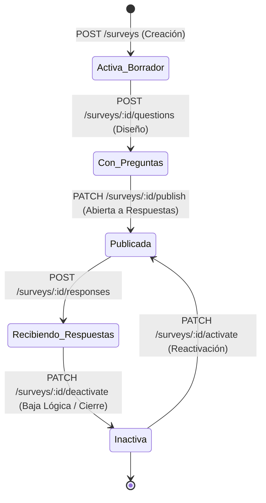
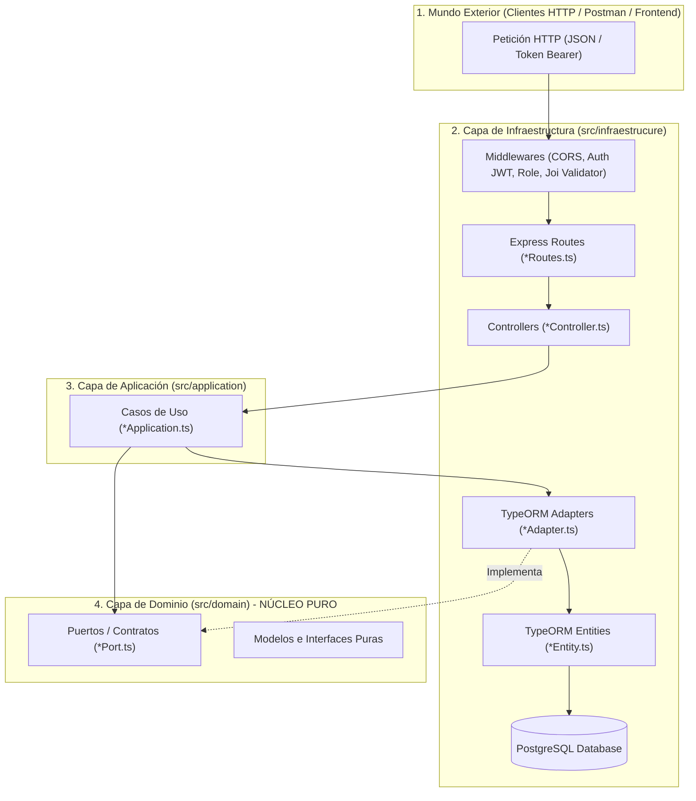
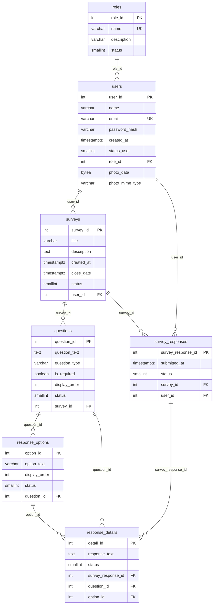
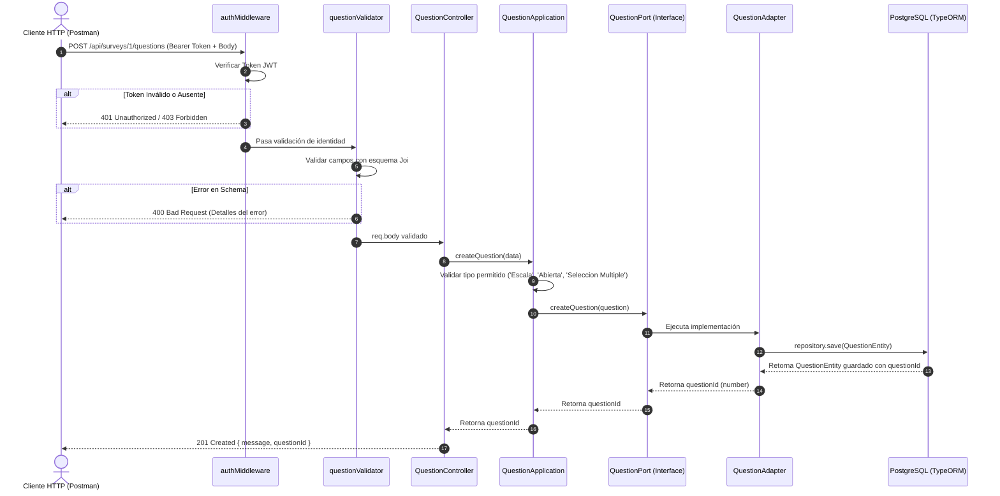

# 📘 DEV3.MD — Manual Técnico Integral del Sistema de Encuestas

> **Documento Oficial de Arquitectura, Dominio, Base de Datos, Flujos y API Reference.**  
> Este documento consolida la arquitectura completa del proyecto, detallando cada capa, entidad, caso de uso, adaptador, flujo de comunicación y endpoint disponible en el backend.

---

## 📑 Tabla de Contenidos
1. [Visión General del Proyecto](#-visión-general-del-proyecto)
2. [Principios de Arquitectura Hexagonal & SOLID](#-principios-de-arquitectura-hexagonal--solid)
3. [Stack Tecnológico](#-stack-tecnológico)
4. [Modelo de Base de Datos & Persistencia](#-modelo-de-base-de-datos--persistencia)
5. [Estructura del Proyecto y Catálogo de Archivos](#-estructura-del-proyecto-y-catálogo-de-archivos)
6. [Trazabilidad y Flujo de Comunicación](#-trazabilidad-y-flujo-de-comunicación)
7. [Módulos del Negocio y CRUDs Implementados](#-módulos-del-negocio-y-cruds-implementados)
8. [Catálogo Completo de Endpoints (API Reference)](#-catálogo-completo-de-endpoints-api-reference)
9. [Guía de Pruebas con Postman y Entorno de Desarrollo](#-guía-de-pruebas-con-postman-y-entorno-de-desarrollo)

---

## 🎯 Visión General del Proyecto

El **Sistema de Gestión de Encuestas** es una plataforma backend RESTful diseñada para administrar el ciclo de vida completo de encuestas institucionales, académicas o empresariales.

### 👥 Actores y Roles del Negocio
* **ADMIN (Administrador - `roleId: 1`):** Control total de la plataforma, gestión de roles de usuario, supervisión de encuestas, usuarios y acceso a estadísticas globales.
* **DOCENTE / CREADOR (`roleId: 2` o personalizado):** Diseña encuestas, configura preguntas (abiertas, escalas, selección múltiple) y analiza resultados y métricas consolidadas de sus encuestas.
* **STUDENT / ENCUESTADO:** Consulta encuestas públicas o activadas y envía respuestas de manera identificada o anónima.

### 🔄 Ciclo de Vida de una Encuesta


---

## 🏛️ Principios de Arquitectura Hexagonal & SOLID

La arquitectura hexagonal (**Ports & Adapters**) aísla completamente las reglas de negocio del framework web (Express), del ORM (TypeORM) y del motor de base de datos (PostgreSQL).



### 💎 Aplicación de Principios SOLID
1. **Single Responsibility Principle (SRP):**
   - El *Controller* solo procesa parámetros HTTP y genera respuestas JSON.
   - La clase *Application* orquesta exclusivamente reglas del dominio.
   - El *Adapter* traduce entidades de TypeORM al modelo puro del dominio.
2. **Open/Closed Principle (OCP):**
   - El dominio está abierto a la extensión mediante la implementación de nuevos adaptadores (por ejemplo, Mongo o MySQL) sin modificar la capa de aplicación.
3. **Liskov Substitution Principle (LSP):**
   - Cualquier adaptador implementa de forma íntegra las interfaces `*Port`, pudiendo reemplazarse sin alterar los casos de uso.
4. **Interface Segregation Principle (ISP):**
   - Interfaces pequeñas y desacopladas: [UserPort.ts](file:///c:/Users/PC/Documents/WorkSpace/Proyecto_Encuestas/src/domain/UserPort.ts), [SurveyPort.ts](file:///c:/Users/PC/Documents/WorkSpace/Proyecto_Encuestas/src/domain/SurveyPort.ts), [QuestionPort.ts](file:///c:/Users/PC/Documents/WorkSpace/Proyecto_Encuestas/src/domain/QuestionPort.ts), [ResponseOptionPort.ts](file:///c:/Users/PC/Documents/WorkSpace/Proyecto_Encuestas/src/domain/ResponseOptionPort.ts), [RolePort.ts](file:///c:/Users/PC/Documents/WorkSpace/Proyecto_Encuestas/src/domain/RolePort.ts) y [SurveyResponsePort.ts](file:///c:/Users/PC/Documents/WorkSpace/Proyecto_Encuestas/src/domain/SurveyResponsePort.ts).
5. **Dependency Inversion Principle (DIP):**
   - La capa de aplicación depende de abstracciones (`Port`), nunca de implementaciones concretas de base de datos o librerías externas.

---

## 🛠️ Stack Tecnológico

| Componente | Tecnología | Versión / Propósito |
| :--- | :--- | :--- |
| **Entorno de Ejecución** | Node.js | v20+ / TypeScript v5.8 |
| **Framework HTTP** | Express.js | v4.21.2 |
| **ORM & Persistencia** | TypeORM | v0.3.20 |
| **Motor de Base de Datos** | PostgreSQL | v14+ con soporte para `BYTEA` y `TIMESTAMPTZ` |
| **Validación de Payloads** | Joi | v17.13.3 (validaciones estrictas de esquemas) |
| **Seguridad de Passwords** | bcryptjs | v3.0.3 (hashing con salt cost factor 10) |
| **Autenticación** | JSON Web Token (JWT) | v9.0.3 |
| **Compresión de Archivos** | Node.js zlib | Gzip nivel 9 para optimización de avatares en BD |
| **Compilación & Runner** | tsx & tsc | Ejecución ágil con TypeScript puro |

---

## 🗄️ Modelo de Base de Datos & Persistencia

El sistema implementa **identificadores numéricos enteros autoincrementales (`SERIAL / INT`)** y una política estricta de **baja lógica sin borrado físico**:
- `status = 1`: Registro **ACTIVO**.
- `status = 0`: Registro **INACTIVO** (dado de baja lógicamente).

### Diagrama Entidad-Relación (Mermaid)


---

## 📁 Estructura del Proyecto y Catálogo de Archivos

```text
Proyecto_Encuestas/
├── .env                                  # Variables de entorno locales
├── nodemon.json                          # Configuración de reinicio en caliente
├── package.json                          # Dependencias y scripts
├── tsconfig.json                         # Configuración de TypeScript
├── Proyecto_Encuestas.postman_collection.json # Colección oficial de Postman
├── README.MD                             # Documentación de inicio
├── DEV3.MD                               # Documentación técnica maestra (este archivo)
└── src/
    ├── index.ts                          # Punto de entrada (inicializa DB y servidor)
    │
    ├── domain/                           # 🔴 NÚCLEO DE DOMINIO (Puro, sin dependencias)
    │   ├── Role.ts                       # Modelo de Rol
    │   ├── RolePort.ts                   # Puerto de persistencia para Roles
    │   ├── User.ts                       # Modelo de Usuario
    │   ├── UserPort.ts                   # Puerto de persistencia para Usuarios
    │   ├── Survey.ts                     # Modelo de Encuesta
    │   ├── SurveyPort.ts                 # Puerto de persistencia para Encuestas
    │   ├── Question.ts                   # Modelo de Pregunta de Encuesta
    │   ├── QuestionPort.ts               # Puerto de persistencia para Preguntas
    │   ├── ResponseOption.ts             # Modelo de Opción de Respuesta
    │   ├── ResponseOptionPort.ts         # Puerto de persistencia para Opciones
    │   ├── SurveyResponse.ts             # Modelos de Respuestas (Encabezado y Detalle)
    │   └── SurveyResponsePort.ts         # Puerto de persistencia y métricas de Respuestas
    │
    ├── application/                      # 🟡 CASOS DE USO (Lógica del Negocio)
    │   ├── AuthApplication.ts           # Generación y verificación de tokens JWT
    │   ├── RoleApplication.ts           # Reglas de negocio para roles
    │   ├── UserApplication.ts           # Casos de uso de usuarios y login
    │   ├── SurveyApplication.ts         # Lógica de encuestas, publicación y filtros
    │   ├── QuestionApplication.ts       # Lógica de preguntas y validación de tipos
    │   ├── ResponseOptionApplication.ts # Lógica para opciones de selección
    │   └── SurveyResponseApplication.ts # Procesamiento de respuestas y estadísticas
    │
    └── infraestrucure/                   # 🟢 INFRAESTRUCTURA (Conexión al exterior)
        ├── adapter/                      # Adaptadores TypeORM
        │   ├── RoleAdapter.ts            # Implementa RolePort
        │   ├── UserAdapter.ts            # Implementa UserPort (compresión BYTEA)
        │   ├── SurveyAdapter.ts          # Implementa SurveyPort (carga anidada)
        │   ├── QuestionAdapter.ts        # Implementa QuestionPort (cascade options)
        │   ├── ResponseOptionAdapter.ts  # Implementa ResponseOptionPort
        │   └── SurveyResponseAdapter.ts  # Implementa SurveyResponsePort (agregaciones)
        ├── bootstrap/
        │   └── server.bootstrap.ts       # Configuración del servidor HTTP nativo
        ├── config/
        │   ├── data-base.ts              # DataSource TypeORM y conexión Postgres
        │   └── environment-vars.ts       # Validación Joi de variables de entorno
        ├── controller/                   # Controladores HTTP de Express
        │   ├── RoleController.ts
        │   ├── UserController.ts
        │   ├── SurveyController.ts
        │   ├── QuestionController.ts
        │   ├── ResponseOptionController.ts
        │   └── SurveyResponseController.ts
        ├── entities/                     # Mapeo ORM TypeORM a tablas SQL
        │   ├── RoleEntity.ts
        │   ├── User.ts (UserEntity)
        │   ├── Survey.ts (SurveyEntity)
        │   ├── QuestionEntity.ts
        │   ├── ResponseOptionEntity.ts
        │   ├── SurveyResponseEntity.ts
        │   └── ResponseDetailEntity.ts
        ├── routes/                       # Enrutadores Express
        │   ├── RoleRoutes.ts
        │   ├── UserRoutes.ts
        │   ├── SurveyRoutes.ts
        │   ├── QuestionRoutes.ts
        │   ├── ResponseOptionRoutes.ts
        │   └── surveyResponseRoutes.ts
        ├── util/                         # Validadores y utilidades
        │   ├── email-validation.ts       # Validador de correo en params
        │   ├── imageCompressor.ts        # Compresión gzip / descompresión de foto
        │   ├── jwt-middleware.ts         # Re-export de autenticación
        │   ├── questionValidator.ts      # Esquemas Joi para preguntas y opciones
        │   ├── role-validation.ts        # Esquemas Joi para roles
        │   ├── surveyResponseValidator.ts# Esquemas Joi para envío de respuestas
        │   ├── surveyValidator.ts        # Esquema Joi para crear encuesta
        │   ├── survey-update-validation.ts# Esquema Joi para actualizar encuesta
        │   ├── user_validation.ts        # Esquema Joi para registro de usuario
        │   └── user-update-validation.ts # Esquema Joi para actualizar usuario
        └── web/
            ├── app.ts                    # Clase App Express y registro global de rutas
            ├── authMiddleware.ts         # Middleware para validar Token Bearer
            └── roleMiddleware.ts         # Middleware para autorización RBAC
```

---

## ⚡ Trazabilidad y Flujo de Comunicación

Para comprender cómo fluye una petición desde el cliente hasta la base de datos y regresa, observemos el siguiente diagrama de secuencia para la creación de una pregunta:



---

## 🧩 Módulos del Negocio y CRUDs Implementados

### 1. Módulo: Roles (`roles`)
* **Propósito:** Definir los niveles de permiso dentro del sistema.
* **Características:**
  - Nombres únicos y normalizados en mayúsculas (`ADMIN`, `DOCENTE`, `STUDENT`).
  - Baja lógica sin borrado físico mediante `PATCH /roles/:id/deactivate`.
  - Reactivación lógica mediante `PATCH /roles/:id/activate`.

### 2. Módulo: Usuarios y Autenticación (`users`)
* **Propósito:** Gestión de cuentas de usuario, inicio de sesión seguro y foto de perfil.
* **Características:**
  - **Hashing seguro:** Contraseñas protegidas mediante `bcryptjs` con factor de coste 10.
  - **Tokens JWT:** Generación de token firmado para proteger rutas y transportar el payload del usuario.
  - **Foto de perfil optimizada:** El avatar en Base64 se comprime con `gzip` a un búfer binario y se guarda en columnas `BYTEA` (`photo_data`) y `photo_mime_type`. Al consultar el usuario, se descomprime automáticamente y se entrega en formato Data URI (`data:image/jpeg;base64,...`).
  - **Endpoint de perfil propio:** `GET /users/me` obtiene la información del usuario autenticado sin requerir ingresar su ID en la URL.

### 3. Módulo: Encuestas (`surveys`)
* **Propósito:** Administración de instrumentos de recolección de información.
* **Características:**
  - Consulta detallada relacional: `GET /surveys/:id` incluye todas las preguntas y sus opciones disponibles, lista para ser renderizada en el frontend.
  - Consulta por creador: `GET /users/:userId/surveys` permite que un docente vea únicamente las encuestas que ha diseñado.
  - Control de publicación: Una encuesta en estado borrador puede ser activada/publicada para permitir respuestas.

### 4. Módulo: Preguntas (`questions`)
* **Propósito:** Formular los ítems que componen la encuesta.
* **Tipos soportados:**
  - `'Escala'`: Preguntas cuantitativas de valoración (1 a 5, Likert, etc.).
  - `'Seleccion Multiple'`: Preguntas de opción única o múltiple alternativa.
  - `'Abierta'`: Preguntas de respuesta libre textual.
* **Creación en cascada:** Permite enviar las preguntas con un arreglo de opciones de respuesta en una sola petición.

### 5. Módulo: Opciones de Respuesta (`response_options`)
* **Propósito:** Configurar las opciones seleccionables para preguntas de Escala o Selección Múltiple.
* **Características:** Ordenamiento mediante `displayOrder` y posibilidad de inactivación individual.

### 6. Módulo: Respuestas y Estadísticas (`survey_responses` & `response_details`)
* **Propósito:** Captura de envíos de los participantes y generación de métricas analíticas.
* **Características:**
  - **Defensiva de Negocio:** Valida que la encuesta exista, esté activa (`status = 1`) y que la fecha de cierre no haya caducado.
  - **Detalle Legible:** `GET /surveys/:id/responses` entrega el nombre del usuario, el enunciado de la pregunta y el texto de la opción elegida.
  - **Consolidado Analítico:** `GET /surveys/:id/statistics` procesa en el backend el conteo de votos por opción y reúne las respuestas abiertas en un formato ideal para tableros o gráficas.

---

## 📡 Catálogo Completo de Endpoints (API Reference)

**Base URL:** `http://localhost:3000/api`

---

### 🎭 1. Módulo: Roles

| Método | Endpoint | Acceso / Auth | Descripción |
| :--- | :--- | :--- | :--- |
| `GET` | `/roles` | Público | Lista todos los roles activos. |
| `GET` | `/roles?includeInactive=true` | Público | Lista todos los roles (incluye inactivos). |
| `GET` | `/roles/:id` | Público | Obtiene el detalle de un rol por ID. |
| `POST` | `/roles` | Bearer Token (ADMIN) | Crea un nuevo rol. |
| `PUT` | `/roles/:id` | Bearer Token (ADMIN) | Actualiza nombre o descripción de un rol. |
| `PATCH` | `/roles/:id/deactivate` | Bearer Token (ADMIN) | Inactiva lógicamente un rol (`status = 0`). |
| `PATCH` | `/roles/:id/activate` | Bearer Token (ADMIN) | Reactiva un rol (`status = 1`). |
| `DELETE` | `/roles/:id` | Bearer Token (ADMIN) | Baja lógica equivalente a inactivar. |

**Payload Ejemplo (`POST /roles`):**
```json
{
  "name": "COORDINADOR",
  "description": "Coordinador de área con permisos sobre encuestas"
}
```

---

### 👤 2. Módulo: Usuarios y Autenticación

| Método | Endpoint | Acceso / Auth | Descripción |
| :--- | :--- | :--- | :--- |
| `POST` | `/users` | Público | Registra un nuevo usuario con avatar opcional. |
| `POST` | `/users/login` | Público | Inicia sesión y genera el Token JWT. |
| `GET` | `/users/me` | Bearer Token | Obtiene los datos del usuario autenticado. |
| `GET` | `/users` | Bearer Token | Lista todos los usuarios activos. |
| `GET` | `/users?includeInactive=true` | Bearer Token | Lista todos los usuarios incluyendo inactivos. |
| `GET` | `/users/:id` | Bearer Token | Obtiene un usuario por su ID. |
| `GET` | `/users/email/:email` | Bearer Token | Obtiene un usuario por correo electrónico. |
| `PUT` | `/users/:id` | Bearer Token | Actualiza información o foto del usuario. |
| `PATCH` | `/users/:id/deactivate` | Bearer Token (ADMIN) | Inactivación lógica del usuario. |
| `PATCH` | `/users/:id/activate` | Bearer Token (ADMIN) | Reactivación lógica del usuario. |
| `DELETE` | `/users/:id` | Bearer Token (ADMIN) | Baja lógica vía DELETE. |

**Payload Ejemplo (`POST /users/login`):**
```json
{
  "email": "admin@encuestas.com",
  "password": "123456Password!"
}
```
**Respuesta:**
```json
{
  "message": "Inicio de sesión exitoso",
  "token": "eyJhbGciOiJIUzI1NiIsInR5cCI6IkpXVCJ9...",
  "user": {
    "id": 1,
    "name": "Administrador del Sistema",
    "email": "admin@encuestas.com",
    "roleId": 1
  }
}
```

---

### 📋 3. Módulo: Encuestas

| Método | Endpoint | Acceso / Auth | Descripción |
| :--- | :--- | :--- | :--- |
| `GET` | `/surveys` | Público | Lista todas las encuestas activas. |
| `GET` | `/surveys/:id` | Público | Obtiene la encuesta completa con sus preguntas y opciones. |
| `GET` | `/users/:userId/surveys` | Bearer Token | Lista las encuestas creadas por un usuario determinado. |
| `POST` | `/surveys` | Bearer Token | Crea una nueva encuesta asociada al usuario autenticado. |
| `PUT` | `/surveys/:id` | Bearer Token | Actualización parcial de título, descripción o fecha. |
| `PATCH` | `/surveys/:id/publish` | Bearer Token | Publica/activa la encuesta para recibir respuestas. |
| `PATCH` | `/surveys/:id/deactivate` | Bearer Token | Inactiva la encuesta (cierre de encuesta). |
| `PATCH` | `/surveys/:id/activate` | Bearer Token | Reactiva la encuesta. |
| `DELETE` | `/surveys/:id` | Bearer Token | Baja lógica de la encuesta. |

**Payload Ejemplo (`POST /surveys`):**
```json
{
  "title": "Evaluación Docente Semestre 2026-2",
  "description": "Encuesta sobre metodología pedagógica y acompañamiento del docente.",
  "closeDate": "2026-12-20T23:59:59.000Z",
  "userId": 1
}
```

---

### ❓ 4. Módulo: Preguntas

| Método | Endpoint | Acceso / Auth | Descripción |
| :--- | :--- | :--- | :--- |
| `GET` | `/surveys/:surveyId/questions` | Público | Lista todas las preguntas de una encuesta. |
| `GET` | `/questions/:id` | Público | Consulta una pregunta por su identificador. |
| `POST` | `/surveys/:surveyId/questions` | Bearer Token | Crea una pregunta vinculada a la encuesta (con opciones opcionales). |
| `POST` | `/questions` | Bearer Token | Crea una pregunta pasando `surveyId` en el cuerpo. |
| `PUT` | `/questions/:id` | Bearer Token | Actualiza enunciado, tipo u orden de la pregunta. |
| `PATCH` | `/questions/:id/deactivate`| Bearer Token | Inactiva lógicamente la pregunta. |
| `PATCH` | `/questions/:id/activate` | Bearer Token | Reactiva la pregunta. |
| `DELETE` | `/questions/:id` | Bearer Token | Baja lógica de la pregunta. |

**Payload Ejemplo con Opciones en Cascada (`POST /surveys/:surveyId/questions`):**
```json
{
  "questionText": "¿Cómo calificaría la puntualidad y acompañamiento del docente?",
  "questionType": "Seleccion Multiple",
  "isRequired": true,
  "displayOrder": 1,
  "options": [
    { "optionText": "Excelente", "displayOrder": 1 },
    { "optionText": "Bueno", "displayOrder": 2 },
    { "optionText": "Aceptable", "displayOrder": 3 },
    { "optionText": "Deficiente", "displayOrder": 4 }
  ]
}
```

---

### 🔘 5. Módulo: Opciones de Respuesta

| Método | Endpoint | Acceso / Auth | Descripción |
| :--- | :--- | :--- | :--- |
| `GET` | `/questions/:questionId/options` | Público | Lista las opciones de una pregunta. |
| `GET` | `/options/:id` | Público | Obtiene una opción específica por su ID. |
| `POST` | `/questions/:questionId/options` | Bearer Token | Agrega una opción individual a la pregunta. |
| `PUT` | `/options/:id` | Bearer Token | Actualiza el texto o el orden de la opción. |
| `PATCH` | `/options/:id/deactivate` | Bearer Token | Inactiva la opción. |
| `PATCH` | `/options/:id/activate` | Bearer Token | Reactiva la opción. |
| `DELETE` | `/options/:id` | Bearer Token | Baja lógica de la opción. |

---

### 📝 6. Módulo: Respuestas y Métricas

| Método | Endpoint | Acceso / Auth | Descripción |
| :--- | :--- | :--- | :--- |
| `POST` | `/surveys/:surveyId/responses` | Público / Auth Opcional | Envía las respuestas a una encuesta. |
| `GET` | `/surveys/:surveyId/responses` | Bearer Token | Lista todas las respuestas detalladas recibidas. |
| `GET` | `/surveys/:surveyId/statistics`| Bearer Token | Obtiene reporte consolidado y conteo de votos. |

**Payload Ejemplo (`POST /surveys/1/responses`):**
```json
{
  "surveyId": 1,
  "userId": 1,
  "details": [
    {
      "questionId": 1,
      "optionId": 1
    },
    {
      "questionId": 2,
      "responseText": "Excelente metodología pedagógica y dominio del tema."
    }
  ]
}
```

**Respuesta de Estadísticas (`GET /surveys/1/statistics`):**
```json
{
  "surveyId": 1,
  "totalSubmissions": 15,
  "questionsSummary": [
    {
      "questionId": 1,
      "questionText": "¿Cómo calificaría la puntualidad y acompañamiento del docente?",
      "questionType": "Seleccion Multiple",
      "totalAnswers": 15,
      "optionsCount": {
        "Excelente": 10,
        "Bueno": 4,
        "Aceptable": 1,
        "Deficiente": 0
      }
    },
    {
      "questionId": 2,
      "questionText": "¿Qué comentarios o sugerencias tiene para el docente?",
      "questionType": "Abierta",
      "totalAnswers": 8,
      "openAnswers": [
        "Excelente metodología pedagógica y dominio del tema.",
        "Muy buen docente, las clases fueron muy claras."
      ]
    }
  ]
}
```

---

## 🚀 Guía de Pruebas con Postman y Entorno de Desarrollo

### 1. Variables de Entorno (`.env`)
Asegúrate de que el archivo `.env` en la raíz contenga tus credenciales locales de PostgreSQL:
```env
PORT=3000
DB_HOST=localhost
DB_PORT=5432
DB_USER=postgres
DB_PASSWORD=tu_password_aqui
DB_NAME=proyecto_encuestas
```

### 2. Ejecución del Servidor
```bash
# Modo desarrollo con recarga automática
npm run dev

# Compilación a JavaScript puro
npm run build

# Ejecución en producción
npm run start
```

### 3. Colección Oficial de Postman
El proyecto incluye el archivo listo para importar en Postman:
`Proyecto_Encuestas.postman_collection.json`

#### Flujo de Pruebas Recomendado:
1. **Roles:** Ejecutar `Listar todos los roles`.
2. **Login:** Ejecutar `Login (Iniciar Sesión)` con el usuario administrador. El script de prueba de Postman guardará automáticamente el token en la variable `{{token}}`.
3. **Perfil:** Ejecutar `Obtener Perfil Propio (GET /users/me)`.
4. **Encuestas:** Ejecutar `Crear Encuesta`, lo que actualizará `{{surveyId}}`.
5. **Preguntas:** Ejecutar `Crear Pregunta de Selección Múltiple con Opciones` y `Crear Pregunta Abierta`.
6. **Consultar Encuesta Completa:** Ejecutar `Obtener Encuesta por ID` para verificar que la encuesta viene con sus preguntas y opciones anidadas.
7. **Respuestas:** Ejecutar `Enviar Respuestas de Encuesta`.
8. **Métricas:** Ejecutar `Consultar Estadísticas y Métricas Consolidadas`.

