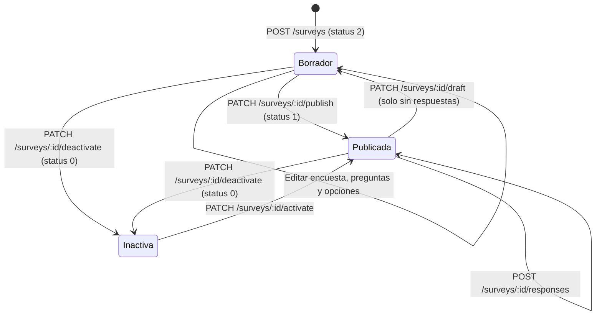
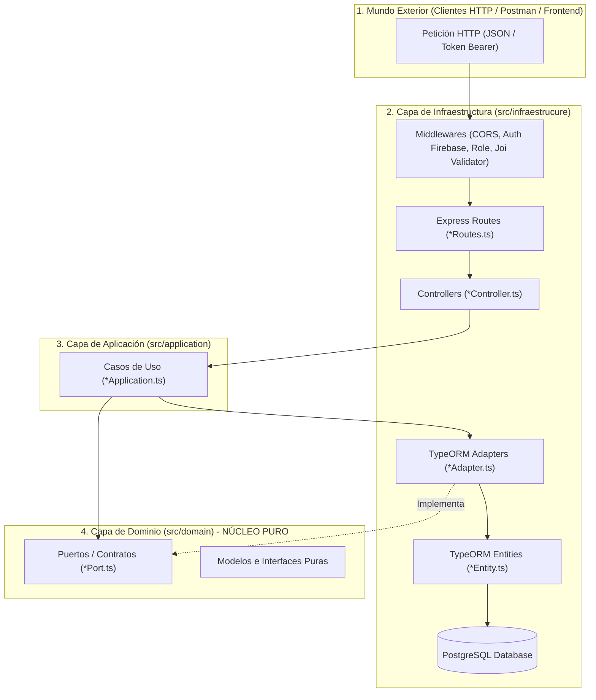
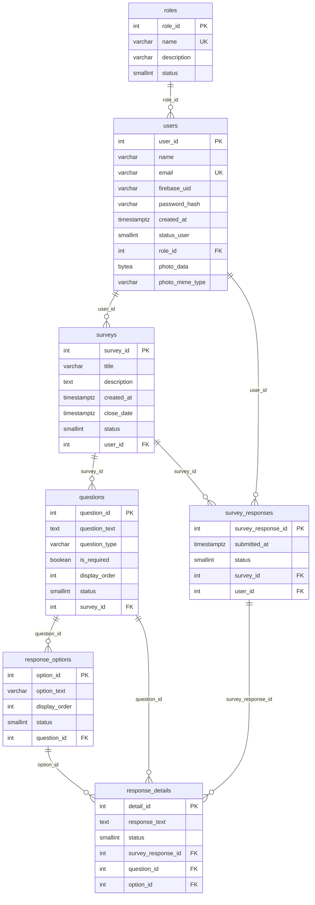
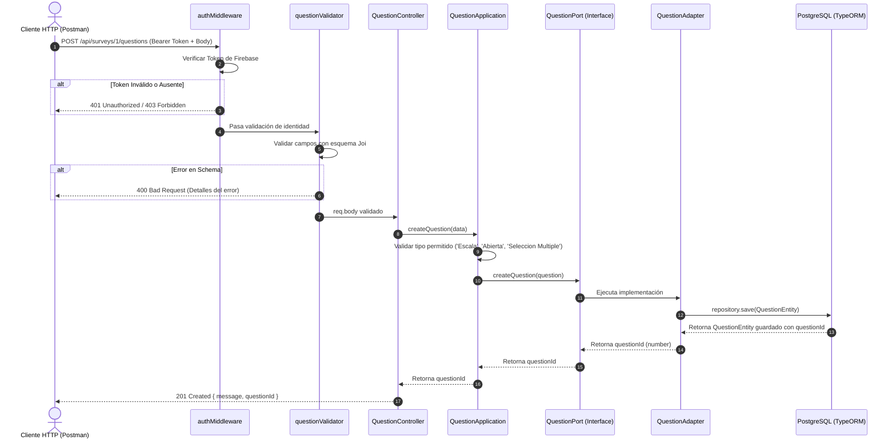

# 📘 DEV3.MD — Manual Técnico Integral del Sistema de Encuestas

> **Documento Oficial de Arquitectura, Dominio, Base de Datos, Flujos y API Reference.**  
> Este documento consolida la arquitectura completa del proyecto, detallando cada capa, entidad, caso de uso, adaptador, flujo de comunicación y endpoint disponible en el backend.

---

## 📑 Tabla de Contenidos
1. [Visión General del Proyecto](#-visión-general-del-proyecto)
2. [Principios de Arquitectura Hexagonal & SOLID](#-principios-de-arquitectura-hexagonal--solid)
3. [Stack Tecnológico](#-stack-tecnológico)
4. [Modelo de Base de Datos & Persistencia](#-modelo-de-base-de-datos--persistencia)
5. [Estructura del Proyecto y Catálogo de Archivos](#-estructura-del-proyecto-y-catálogo-de-archivos)
6. [Trazabilidad y Flujo de Comunicación](#-trazabilidad-y-flujo-de-comunicación)
7. [Módulos del Negocio y CRUDs Implementados](#-módulos-del-negocio-y-cruds-implementados)
8. [Catálogo Completo de Endpoints (API Reference)](#-catálogo-completo-de-endpoints-api-reference)
9. [Guía de Pruebas con Postman y Entorno de Desarrollo](#-guía-de-pruebas-con-postman-y-entorno-de-desarrollo)

---

## 🎯 Visión General del Proyecto

El **Sistema de Gestión de Encuestas** es una plataforma backend RESTful diseñada para administrar el ciclo de vida completo de encuestas institucionales, académicas o empresariales.

### 👥 Actores y Roles del Negocio
* **ADMIN (Administrador - `roleId: 1`):** Control total de la plataforma: gestión de roles y usuarios, diseño de encuestas (preguntas abiertas, escalas, selección múltiple) y acceso a resultados y estadísticas.
* **STUDENT / ENCUESTADO (`roleId: 2`):** Con sesión iniciada consulta las encuestas publicadas y responde cada una una sola vez.

### 🔄 Ciclo de Vida de una Encuesta


---

## 🏛️ Principios de Arquitectura Hexagonal & SOLID

La arquitectura hexagonal (**Ports & Adapters**) aísla completamente las reglas de negocio del framework web (Express), del ORM (TypeORM) y del motor de base de datos (PostgreSQL).



### 💎 Aplicación de Principios SOLID
1. **Single Responsibility Principle (SRP):**
   - El *Controller* solo procesa parámetros HTTP y genera respuestas JSON.
   - La clase *Application* orquesta exclusivamente reglas del dominio.
   - El *Adapter* traduce entidades de TypeORM al modelo puro del dominio.
2. **Open/Closed Principle (OCP):**
   - El dominio está abierto a la extensión mediante la implementación de nuevos adaptadores (por ejemplo, Mongo o MySQL) sin modificar la capa de aplicación.
3. **Liskov Substitution Principle (LSP):**
   - Cualquier adaptador implementa de forma íntegra las interfaces `*Port`, pudiendo reemplazarse sin alterar los casos de uso.
4. **Interface Segregation Principle (ISP):**
   - Interfaces pequeñas y desacopladas: [UserPort.ts](file:///c:/Users/PC/Documents/WorkSpace/Proyecto_Encuestas/src/domain/UserPort.ts), [SurveyPort.ts](file:///c:/Users/PC/Documents/WorkSpace/Proyecto_Encuestas/src/domain/SurveyPort.ts), [QuestionPort.ts](file:///c:/Users/PC/Documents/WorkSpace/Proyecto_Encuestas/src/domain/QuestionPort.ts), [ResponseOptionPort.ts](file:///c:/Users/PC/Documents/WorkSpace/Proyecto_Encuestas/src/domain/ResponseOptionPort.ts), [RolePort.ts](file:///c:/Users/PC/Documents/WorkSpace/Proyecto_Encuestas/src/domain/RolePort.ts) y [SurveyResponsePort.ts](file:///c:/Users/PC/Documents/WorkSpace/Proyecto_Encuestas/src/domain/SurveyResponsePort.ts).
5. **Dependency Inversion Principle (DIP):**
   - La capa de aplicación depende de abstracciones (`Port`), nunca de implementaciones concretas de base de datos o librerías externas.

---

## 🛠️ Stack Tecnológico

| Componente | Tecnología | Versión / Propósito |
| :--- | :--- | :--- |
| **Entorno de Ejecución** | Node.js | v20+ / TypeScript v5.8 |
| **Framework HTTP** | Express.js | v4.21.2 |
| **ORM & Persistencia** | TypeORM | v0.3.20 |
| **Motor de Base de Datos** | PostgreSQL | v14+ con soporte para `BYTEA` y `TIMESTAMPTZ` |
| **Validación de Payloads** | Joi | v17.13.3 (validaciones estrictas de esquemas) |
| **Autenticación** | Firebase Authentication (`firebase-admin`) | v14 |
| **Compresión de Archivos** | Node.js zlib | Gzip nivel 9 para optimización de avatares en BD |
| **Compilación & Runner** | tsx & tsc | Ejecución ágil con TypeScript puro |

---

## 🗄️ Modelo de Base de Datos & Persistencia

El sistema implementa **identificadores numéricos enteros autoincrementales (`SERIAL / INT`)** y una política estricta de **baja lógica sin borrado físico**:
- `status = 1`: Registro **ACTIVO**.
- `status = 0`: Registro **INACTIVO** (dado de baja lógicamente).

### Diagrama Entidad-Relación (Mermaid)


---

## 📁 Estructura del Proyecto y Catálogo de Archivos

```text
Proyecto_Encuestas/
├── .env                                  # Variables de entorno locales
├── nodemon.json                          # Configuración de reinicio en caliente
├── package.json                          # Dependencias y scripts
├── tsconfig.json                         # Configuración de TypeScript
├── Proyecto_Encuestas.postman_collection.json # Colección oficial de Postman
├── README.MD                             # Documentación de inicio
├── DEV3.MD                               # Documentación técnica maestra (este archivo)
└── src/
    ├── index.ts                          # Punto de entrada (inicializa DB y servidor)
    │
    ├── domain/                           # 🔴 NÚCLEO DE DOMINIO (Puro, sin dependencias)
    │   ├── Role.ts                       # Modelo de Rol
    │   ├── RolePort.ts                   # Puerto de persistencia para Roles
    │   ├── User.ts                       # Modelo de Usuario
    │   ├── UserPort.ts                   # Puerto de persistencia para Usuarios
    │   ├── Survey.ts                     # Modelo de Encuesta
    │   ├── SurveyPort.ts                 # Puerto de persistencia para Encuestas
    │   ├── Question.ts                   # Modelo de Pregunta de Encuesta
    │   ├── QuestionPort.ts               # Puerto de persistencia para Preguntas
    │   ├── ResponseOption.ts             # Modelo de Opción de Respuesta
    │   ├── ResponseOptionPort.ts         # Puerto de persistencia para Opciones
    │   ├── SurveyResponse.ts             # Modelos de Respuestas (Encabezado y Detalle)
    │   └── SurveyResponsePort.ts         # Puerto de persistencia y métricas de Respuestas
    │
    ├── application/                      # 🟡 CASOS DE USO (Lógica del Negocio)
    │   ├── RoleApplication.ts           # Reglas de negocio para roles
    │   ├── UserApplication.ts           # Casos de uso de usuarios y sesión
    │   ├── SurveyApplication.ts         # Lógica de encuestas, publicación y filtros
    │   ├── QuestionApplication.ts       # Lógica de preguntas y validación de tipos
    │   ├── ResponseOptionApplication.ts # Lógica para opciones de selección
    │   └── SurveyResponseApplication.ts # Procesamiento de respuestas y estadísticas
    │
    └── infraestrucure/                   # 🟢 INFRAESTRUCTURA (Conexión al exterior)
        ├── adapter/                      # Adaptadores TypeORM
        │   ├── RoleAdapter.ts            # Implementa RolePort
        │   ├── UserAdapter.ts            # Implementa UserPort (compresión BYTEA)
        │   ├── SurveyAdapter.ts          # Implementa SurveyPort (carga anidada)
        │   ├── QuestionAdapter.ts        # Implementa QuestionPort (cascade options)
        │   ├── ResponseOptionAdapter.ts  # Implementa ResponseOptionPort
        │   └── SurveyResponseAdapter.ts  # Implementa SurveyResponsePort (agregaciones)
        ├── bootstrap/
        │   └── server.bootstrap.ts       # Configuración del servidor HTTP nativo
        ├── config/
        │   ├── data-base.ts              # DataSource TypeORM y conexión Postgres
        │   └── environment-vars.ts       # Validación Joi de variables de entorno
        ├── controller/                   # Controladores HTTP de Express
        │   ├── RoleController.ts
        │   ├── UserController.ts
        │   ├── SurveyController.ts
        │   ├── QuestionController.ts
        │   ├── ResponseOptionController.ts
        │   └── SurveyResponseController.ts
        ├── entities/                     # Mapeo ORM TypeORM a tablas SQL
        │   ├── RoleEntity.ts
        │   ├── User.ts (UserEntity)
        │   ├── Survey.ts (SurveyEntity)
        │   ├── QuestionEntity.ts
        │   ├── ResponseOptionEntity.ts
        │   ├── SurveyResponseEntity.ts
        │   └── ResponseDetailEntity.ts
        ├── routes/                       # Enrutadores Express
        │   ├── RoleRoutes.ts
        │   ├── UserRoutes.ts
        │   ├── SurveyRoutes.ts
        │   ├── QuestionRoutes.ts
        │   ├── ResponseOptionRoutes.ts
        │   └── surveyResponseRoutes.ts
        ├── util/                         # Validadores y utilidades
        │   ├── email-validation.ts       # Validador de correo en params
        │   ├── imageCompressor.ts        # Compresión gzip / descompresión de foto
        │   ├── jwt-middleware.ts         # Re-export de autenticación
        │   ├── questionValidator.ts      # Esquemas Joi para preguntas y opciones
        │   ├── role-validation.ts        # Esquemas Joi para roles
        │   ├── surveyResponseValidator.ts# Esquemas Joi para envío de respuestas
        │   ├── surveyValidator.ts        # Esquema Joi para crear encuesta
        │   ├── survey-update-validation.ts# Esquema Joi para actualizar encuesta
        │   ├── user_validation.ts        # Esquema Joi para registro de usuario
        │   └── user-update-validation.ts # Esquema Joi para actualizar usuario
        └── web/
            ├── app.ts                    # Clase App Express y registro global de rutas
            ├── authMiddleware.ts         # Middleware para validar Token Bearer
            └── roleMiddleware.ts         # Middleware para autorización RBAC
```

---

## ⚡ Trazabilidad y Flujo de Comunicación

Para comprender cómo fluye una petición desde el cliente hasta la base de datos y regresa, observemos el siguiente diagrama de secuencia para la creación de una pregunta:



---

## 🧩 Módulos del Negocio y CRUDs Implementados

### 1. Módulo: Roles (`roles`)
* **Propósito:** Definir los niveles de permiso dentro del sistema.
* **Características:**
  - Nombres únicos y normalizados en mayúsculas (`ADMIN`, `STUDENT`).
  - Baja lógica sin borrado físico mediante `PATCH /roles/:id/deactivate`.
  - Reactivación lógica mediante `PATCH /roles/:id/activate`.

### 2. Módulo: Usuarios y Autenticación (`users`)
* **Propósito:** Gestión de cuentas de usuario, inicio de sesión seguro y foto de perfil.
* **Características:**
  - **Firebase Authentication:** El inicio de sesión, el registro y la recuperación de contraseña se hacen en Firebase. El backend valida el token en cada petición y crea al usuario como `STUDENT` en su primer ingreso. El rol siempre se toma de PostgreSQL.
  - **Foto de perfil optimizada:** El avatar en Base64 se comprime con `gzip` a un búfer binario y se guarda en columnas `BYTEA` (`photo_data`) y `photo_mime_type`. Al consultar el usuario, se descomprime automáticamente y se entrega en formato Data URI (`data:image/jpeg;base64,...`).
  - **Endpoint de perfil propio:** `GET /users/me` obtiene la información del usuario autenticado sin requerir ingresar su ID en la URL.

### 3. Módulo: Encuestas (`surveys`)
* **Propósito:** Administración de instrumentos de recolección de información.
* **Características:**
  - Consulta detallada relacional: `GET /surveys/:id` incluye todas las preguntas y sus opciones disponibles, lista para ser renderizada en el frontend.
  - Consulta por creador: `GET /users/:userId/surveys` permite al administrador ver las encuestas diseñadas por un usuario.
  - Control de publicación: Toda encuesta nace en borrador (`status = 2`). Solo en borrador se edita la encuesta, sus preguntas y sus opciones, y para publicarla necesita al menos una pregunta activa.

### 4. Módulo: Preguntas (`questions`)
* **Propósito:** Formular los ítems que componen la encuesta.
* **Tipos soportados:**
  - `'Escala'`: Preguntas cuantitativas de valoración (1 a 5, Likert, etc.).
  - `'Seleccion Multiple'`: Preguntas de opción única o múltiple alternativa.
  - `'Abierta'`: Preguntas de respuesta libre textual.
* **Creación en cascada:** Permite enviar las preguntas con un arreglo de opciones de respuesta en una sola petición.

### 5. Módulo: Opciones de Respuesta (`response_options`)
* **Propósito:** Configurar las opciones seleccionables para preguntas de Escala o Selección Múltiple.
* **Características:** Ordenamiento mediante `displayOrder` y posibilidad de inactivación individual.

### 6. Módulo: Respuestas y Estadísticas (`survey_responses` & `response_details`)
* **Propósito:** Captura de envíos de los participantes y generación de métricas analíticas.
* **Características:**
  - **Defensiva de Negocio:** Exige sesión; valida que la encuesta esté publicada (`status = 1`) y vigente, que el usuario no la haya respondido antes, que cada respuesta corresponda a una pregunta y opción activas de la encuesta y que se contesten las obligatorias.
  - **Detalle Legible:** `GET /surveys/:id/responses` entrega el nombre del usuario, el enunciado de la pregunta y el texto de la opción elegida.
  - **Consolidado Analítico:** `GET /surveys/:id/statistics` procesa en el backend el conteo de votos por opción y reúne las respuestas abiertas en un formato ideal para tableros o gráficas.

---

## 📡 Catálogo Completo de Endpoints (API Reference)

**Base URL:** `http://localhost:3000/api`

---

### 🎭 1. Módulo: Roles

| Método | Endpoint | Acceso / Auth | Descripción |
| :--- | :--- | :--- | :--- |
| `GET` | `/roles` | Bearer Token (ADMIN) | Lista todos los roles activos. |
| `GET` | `/roles?includeInactive=true` | Bearer Token (ADMIN) | Lista todos los roles (incluye inactivos). |
| `GET` | `/roles/:id` | Bearer Token (ADMIN) | Obtiene el detalle de un rol por ID. |
| `POST` | `/roles` | Bearer Token (ADMIN) | Crea un nuevo rol. |
| `PUT` | `/roles/:id` | Bearer Token (ADMIN) | Actualiza nombre o descripción de un rol. |
| `PATCH` | `/roles/:id/deactivate` | Bearer Token (ADMIN) | Inactiva lógicamente un rol (`status = 0`). |
| `PATCH` | `/roles/:id/activate` | Bearer Token (ADMIN) | Reactiva un rol (`status = 1`). |
| `DELETE` | `/roles/:id` | Bearer Token (ADMIN) | Baja lógica equivalente a inactivar. |

**Payload Ejemplo (`POST /roles`):**
```json
{
  "name": "COORDINADOR",
  "description": "Coordinador de área con permisos sobre encuestas"
}
```

---

### 👤 2. Módulo: Usuarios y Autenticación

| Método | Endpoint | Acceso / Auth | Descripción |
| :--- | :--- | :--- | :--- |
| `GET` | `/users/me` | Bearer Token | Obtiene los datos del usuario autenticado. |
| `GET` | `/users` | Bearer Token (ADMIN) | Lista todos los usuarios activos. |
| `GET` | `/users?includeInactive=true` | Bearer Token (ADMIN) | Lista todos los usuarios incluyendo inactivos. |
| `GET` | `/users/:id` | Bearer Token (propio o ADMIN) | Obtiene un usuario por su ID. |
| `GET` | `/users/email/:email` | Bearer Token (ADMIN) | Obtiene un usuario por correo electrónico. |
| `PUT` | `/users/:id` | Bearer Token (propio o ADMIN) | Actualiza nombre o foto del usuario. |
| `PATCH` | `/users/:id/deactivate` | Bearer Token (ADMIN) | Inactivación lógica del usuario. |
| `PATCH` | `/users/:id/activate` | Bearer Token (ADMIN) | Reactivación lógica del usuario. |
| `DELETE` | `/users/:id` | Bearer Token (ADMIN) | Baja lógica vía DELETE. |

El inicio de sesión y el registro se hacen en Firebase. Todas las peticiones protegidas envían el token de Firebase en `Authorization: Bearer <token>`.

El administrador inicial se enlaza por su UID de Firebase:
```sql
UPDATE users SET firebase_uid = 'UID_DE_LA_CUENTA_EN_FIREBASE' WHERE user_id = 1;
```

---

### 📋 3. Módulo: Encuestas

| Método | Endpoint | Acceso / Auth | Descripción |
| :--- | :--- | :--- | :--- |
| `GET` | `/surveys` | Bearer Token | Lista las encuestas publicadas, sin preguntas, con `questionCount` y `answered` para el usuario de la sesión (ADMIN puede usar `?includeInactive=true`). |
| `GET` | `/surveys/:id` | Bearer Token | Obtiene la encuesta completa con sus preguntas y opciones. |
| `GET` | `/users/:userId/surveys` | Bearer Token (ADMIN) | Lista las encuestas creadas por un usuario determinado. |
| `POST` | `/surveys` | Bearer Token (ADMIN) | Crea una encuesta en borrador asociada al usuario autenticado. |
| `PUT` | `/surveys/:id` | Bearer Token (ADMIN) | Actualización parcial de título, descripción o fecha (solo en borrador). |
| `PATCH` | `/surveys/:id/publish` | Bearer Token (ADMIN) | Publica un borrador para recibir respuestas. |
| `PATCH` | `/surveys/:id/draft` | Bearer Token (ADMIN) | Devuelve a borrador una encuesta publicada sin respuestas. |
| `PATCH` | `/surveys/:id/deactivate` | Bearer Token (ADMIN) | Inactiva la encuesta (cierre de encuesta). |
| `PATCH` | `/surveys/:id/activate` | Bearer Token (ADMIN) | Reactiva la encuesta. |
| `DELETE` | `/surveys/:id` | Bearer Token (ADMIN) | Baja lógica de la encuesta. |

**Payload Ejemplo (`POST /surveys`):**
```json
{
  "title": "Evaluación Docente Semestre 2026-2",
  "description": "Encuesta sobre metodología pedagógica y acompañamiento del docente.",
  "closeDate": "2026-12-20T23:59:59.000Z"
}
```

---

### ❓ 4. Módulo: Preguntas

| Método | Endpoint | Acceso / Auth | Descripción |
| :--- | :--- | :--- | :--- |
| `GET` | `/surveys/:surveyId/questions` | Bearer Token (ADMIN) | Lista todas las preguntas de una encuesta. |
| `GET` | `/questions/:id` | Bearer Token (ADMIN) | Consulta una pregunta por su identificador. |
| `POST` | `/surveys/:surveyId/questions` | Bearer Token (ADMIN) | Crea una pregunta vinculada a la encuesta (con opciones opcionales). |
| `POST` | `/questions` | Bearer Token (ADMIN) | Crea una pregunta pasando `surveyId` en el cuerpo. |
| `PUT` | `/questions/:id` | Bearer Token (ADMIN) | Actualiza enunciado, tipo u orden de la pregunta. |
| `PATCH` | `/questions/:id/deactivate` | Bearer Token (ADMIN) | Inactiva lógicamente la pregunta. |
| `PATCH` | `/questions/:id/activate` | Bearer Token (ADMIN) | Reactiva la pregunta. |
| `DELETE` | `/questions/:id` | Bearer Token (ADMIN) | Baja lógica de la pregunta. |

**Payload Ejemplo con Opciones en Cascada (`POST /surveys/:surveyId/questions`):**
```json
{
  "questionText": "¿Cómo calificaría la puntualidad y acompañamiento del docente?",
  "questionType": "Seleccion Multiple",
  "isRequired": true,
  "displayOrder": 1,
  "options": [
    { "optionText": "Excelente", "displayOrder": 1 },
    { "optionText": "Bueno", "displayOrder": 2 },
    { "optionText": "Aceptable", "displayOrder": 3 },
    { "optionText": "Deficiente", "displayOrder": 4 }
  ]
}
```

---

### 🔘 5. Módulo: Opciones de Respuesta

| Método | Endpoint | Acceso / Auth | Descripción |
| :--- | :--- | :--- | :--- |
| `GET` | `/questions/:questionId/options` | Bearer Token (ADMIN) | Lista las opciones de una pregunta. |
| `GET` | `/options/:id` | Bearer Token (ADMIN) | Obtiene una opción específica por su ID. |
| `POST` | `/questions/:questionId/options` | Bearer Token (ADMIN) | Agrega una opción individual a la pregunta. |
| `PUT` | `/options/:id` | Bearer Token (ADMIN) | Actualiza el texto o el orden de la opción. |
| `PATCH` | `/options/:id/deactivate` | Bearer Token (ADMIN) | Inactiva la opción. |
| `PATCH` | `/options/:id/activate` | Bearer Token (ADMIN) | Reactiva la opción. |
| `DELETE` | `/options/:id` | Bearer Token (ADMIN) | Baja lógica de la opción. |

---

### 📝 6. Módulo: Respuestas y Métricas

| Método | Endpoint | Acceso / Auth | Descripción |
| :--- | :--- | :--- | :--- |
| `POST` | `/surveys/:surveyId/responses` | Bearer Token | Envía las respuestas a una encuesta (una vez por usuario). |
| `GET` | `/users/me/responses` | Bearer Token | Encuestas respondidas por el usuario de la sesión, con lo que contestó. |
| `GET` | `/surveys/:surveyId/responses` | Bearer Token (ADMIN) | Lista todas las respuestas detalladas recibidas. |
| `GET` | `/surveys/:surveyId/statistics` | Bearer Token (ADMIN) | Reporte consolidado: votos, comentarios, promedio, respuestas positivas (4 y 5), neutras (3) y negativas (1 y 2), y participación. Admite `?from=` y `?to=` en formato ISO. |

**Payload Ejemplo (`POST /surveys/1/responses`):**
```json
{
  "details": [
    {
      "questionId": 1,
      "optionId": 1
    },
    {
      "questionId": 2,
      "responseText": "Excelente metodología pedagógica y dominio del tema."
    }
  ]
}
```

**Respuesta de Estadísticas (`GET /surveys/1/statistics`):**
```json
{
  "surveyId": 1,
  "totalSubmissions": 15,
  "questionsSummary": [
    {
      "questionId": 1,
      "questionText": "¿Cómo calificaría la puntualidad y acompañamiento del docente?",
      "questionType": "Seleccion Multiple",
      "totalAnswers": 15,
      "optionsCount": {
        "Excelente": 10,
        "Bueno": 4,
        "Aceptable": 1,
        "Deficiente": 0
      }
    },
    {
      "questionId": 2,
      "questionText": "¿Qué comentarios o sugerencias tiene para el docente?",
      "questionType": "Abierta",
      "totalAnswers": 8,
      "openAnswers": [
        "Excelente metodología pedagógica y dominio del tema.",
        "Muy buen docente, las clases fueron muy claras."
      ]
    }
  ]
}
```

---

### ⚠️ Formato de Errores

Todos los errores responden JSON con la forma `{ "error": "mensaje" }`.

| Código | Significado |
| :--- | :--- |
| `400` | Datos inválidos o acción no permitida en el estado actual de la encuesta. |
| `401` | Sin token, o token inválido o expirado. |
| `403` | Permisos insuficientes o usuario inactivo. |
| `404` | El recurso o la ruta no existen. |
| `409` | Duplicado: correo o rol ya registrado, orden de opción repetido o encuesta ya respondida. |
| `413` | El cuerpo de la petición es demasiado grande. |
| `429` | Demasiadas peticiones desde la misma IP. |
| `500` | Error interno. El detalle solo queda en los logs del servidor. |

---

## 🚀 Guía de Pruebas con Postman y Entorno de Desarrollo

### 1. Variables de Entorno (`.env`)
Copia `.env.example` como `.env` y completa tus credenciales locales de PostgreSQL y el ID del proyecto de Firebase:
```env
PORT=3000
DB_HOST=localhost
DB_PORT=5432
DB_USER=postgres
DB_PASSWORD=tu_password_aqui
DB_NAME=proyecto_encuestas
FIREBASE_PROJECT_ID=id_de_tu_proyecto
FRONTEND_URL=http://localhost:4200
RATE_LIMIT_MAX=600
```

### Base de Datos
* **Base nueva:** ejecuta `init_database.sql`, que no borra datos y se puede repetir, y enlaza al administrador con su UID de Firebase.
* **Base creada con la versión anterior:** ejecuta una vez `ajuste_base_existente.sql` y luego `ajuste_firebase.sql`.

### 2. Ejecución del Servidor
```bash
# Modo desarrollo con recarga automática
npm run dev

# Compilación a JavaScript puro
npm run build

# Ejecución en producción
npm run start
```

### 3. Colección Oficial de Postman
El proyecto incluye el archivo listo para importar en Postman:
`Proyecto_Encuestas.postman_collection.json`

#### Flujo de Pruebas Recomendado:
1. Importa la colección y, en la pestaña **Variables**, completa en la columna *Current value*: `firebaseApiKey`, `adminEmail`, `adminPassword`, `studentEmail` y `studentPassword`, con cuentas reales del proyecto de Firebase.
2. Ejecuta las carpetas en orden, de la 1 a la 9, o usa **Run collection**. Cada petición guarda los IDs y el token que necesita la siguiente.
3. La carpeta 1 inicia sesión en Firebase. Sin ese paso, las demás rutas responden 401.
4. Las preguntas y opciones solo se modifican en borrador, por eso la publicación está en la carpeta 7.
5. Cada ejecución crea una encuesta nueva, ya que un usuario solo puede responder una vez cada encuesta.
